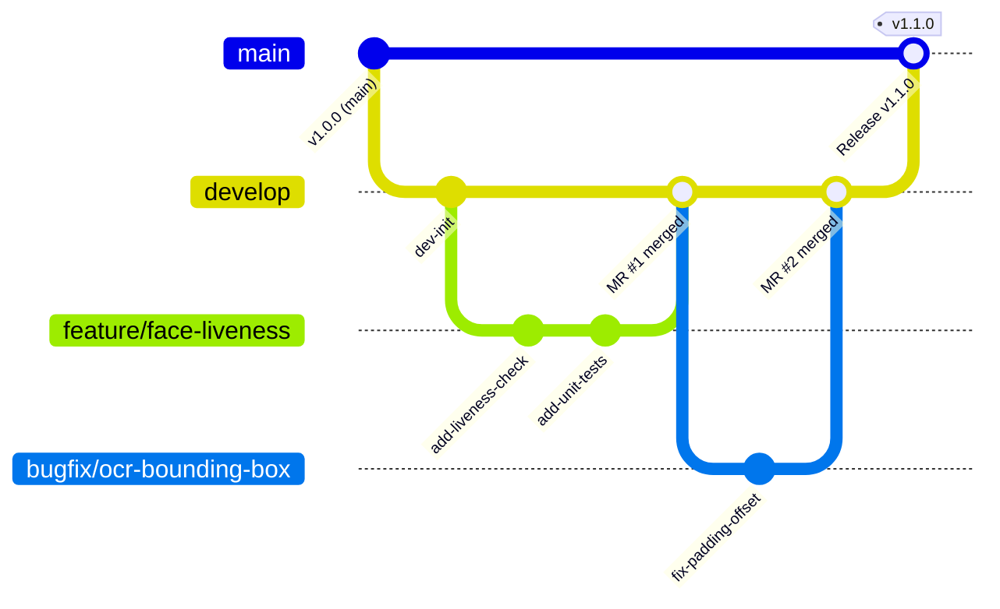
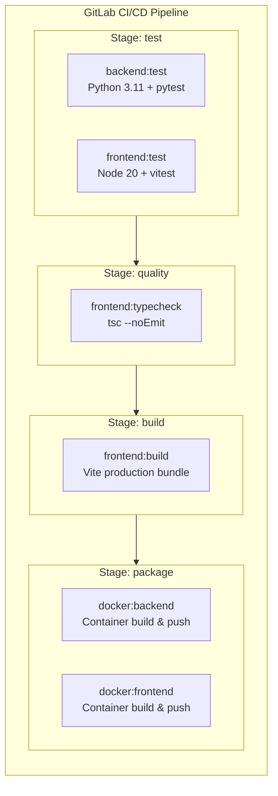

# GitLab Integration & DevOps Workflow Guide

This guide details the complete procedure for connecting the **AI-Powered E-KYC Identity Verification Platform** to your local self-hosted **GitLab Community Edition (CE)** instance, along with professional Git branching, Merge Request (MR) governance, and CI/CD operations.

---

## 1. Connecting the Project to Local GitLab

Your GitLab CE instance is running locally on:
- **Web UI & Git HTTP**: `http://localhost:8929`
- **Git SSH**: `ssh://git@localhost:2224`

### Step 1: Create a New Project in GitLab
1. Open your browser and navigate to [http://localhost:8929](http://localhost:8929).
2. Sign in with your administrator account (`root`) or developer account.
3. Click the **+** (New) button in the top navigation bar &rarr; select **New project/repository**.
4. Select **Create blank project**.
5. Fill in the project details:
   - **Project name**: `ekyc-platform` (or your preferred name).
   - **Project URL**: `http://localhost:8929/<username>/ekyc-platform`
   - **Visibility Level**: **Private** (recommended for identity & biometric compliance).
   - **Project Configuration**: **Uncheck** "Initialize repository with a README" (since we have our existing codebase ready).
6. Click **Create project**.

### Step 2: Configure Local Git Repository & Remotes
Open your PowerShell terminal in the project root:

```powershell
cd "c:\Users\arya singh\EKYC\Project1"

# 1. Verify Git status
git status

# 2. Configure default branch to main
git branch -M main

# 3. Add GitLab as the remote origin (choose HTTP or SSH)
# Option A: HTTP (Easiest for local development)
git remote add origin http://localhost:8929/<username>/ekyc-platform.git

# Option B: SSH (Requires configuring an SSH key in GitLab)
git remote add origin ssh://git@localhost:2224/<username>/ekyc-platform.git

# 4. Verify the remote configuration
git remote -v
```

### Step 3: Initial Commit and Push (Awaiting User Approval)
```powershell
# Stage all verified source code
git add .

# Create initial baseline commit
git commit -m "feat: initial baseline of AI-Powered e-KYC Identity Verification Platform"

# Push to GitLab main branch
git push -u origin main
```

---

## 2. Professional Branching Strategy (GitFlow-Lite)

To ensure code quality and stability, adopt a structured multi-branch workflow:



### Branch Definitions & Conventions:

| Branch | Purpose | Protection Rule | CI/CD Trigger |
| :--- | :--- | :--- | :--- |
| **`main`** | Production-ready, deployable baseline. Represents current stable state. | **Protected**: No direct pushes; requires approved Merge Request. | Full test suite, static checks, and Docker container packaging. |
| **`develop`** | Integration branch where completed features coalesce before release. | **Protected**: Direct pushes restricted; merge requests required. | Full test suite and linting. |
| **`feature/<name>`** | New capability development (e.g. `feature/aadhaar-masking-v2`, `feature/face-anti-spoofing`). | Branches off `develop`; merged back into `develop`. | Backend and frontend unit tests. |
| **`bugfix/<name>`** | Defect repairs for non-critical issues (e.g. `bugfix/admin-pagination`, `bugfix/cors-preflight`). | Branches off `develop`; merged back into `develop`. | Test suite validation. |
| **`hotfix/<name>`** | Emergency production fixes. | Branches off `main`; merged into both `main` and `develop`. | Immediate test and hotfix container build. |

---

## 3. Merge Request (MR) & Governance Workflow

1. **Create a Topic Branch**:
   ```powershell
   git checkout develop
   git pull origin develop
   git checkout -b feature/enhanced-audit-logging
   ```
2. **Develop with Conventional Commits**:
   Follow standard semantic commit prefixes:
   - `feat:` New features or capabilities.
   - `fix:` Bug fixes.
   - `test:` Adding or improving tests.
   - `docs:` Documentation updates.
   - `refactor:` Code reorganization without behavioral change.
   - `chore:` Dependency or tool maintenance.
3. **Push Feature Branch to GitLab**:
   ```powershell
   git push -u origin feature/enhanced-audit-logging
   ```
4. **Open a Merge Request**:
   - In GitLab UI, click **Create merge request**.
   - Set **Source branch**: `feature/enhanced-audit-logging` &rarr; **Target branch**: `develop`.
   - Provide a description of changes and check **Delete source branch when merge request is accepted**.
5. **Review & Automated Validation**:
   - The GitLab CI/CD pipeline triggers automated unit tests and build validation.
   - Review code diffs and approve merge.

---

## 4. GitLab CI/CD Pipeline Architecture

The platform includes a pre-configured [`.gitlab-ci.yml`](file:///c:/Users/arya%20singh/EKYC/Project1/.gitlab-ci.yml) defining 4 automated stages:



### Stage Details:
1. **`test`**:
   - **`backend:test`**: Runs Python 3.11-slim container, installs dependencies from `requirements.txt`, and executes `pytest backend/tests/` with in-memory SQLite fixtures (`conftest.py`). Emits JUnit XML test reports.
   - **`frontend:test`**: Runs Node 20-alpine, executes `npm ci`, and runs `npm test` (`vitest run`).
2. **`quality`**:
   - **`frontend:typecheck`**: Runs `npm run lint` (`tsc --noEmit`) to verify zero TypeScript compile errors.
3. **`build`**:
   - **`frontend:build`**: Runs `npm run build` (`tsc && vite build`) and stores production bundle in artifacts (`frontend-react/dist/`).
4. **`package`**:
   - Builds production Docker images (`Dockerfile.backend` and `Dockerfile.frontend`) and tags them with commit SHA and `latest`.

---

## 5. GitLab Runner Prerequisites (Future Task)

To execute pipeline jobs, a **GitLab Runner** must be registered. When you are ready to configure the runner:

1. Obtain the **Runner Registration Token** from GitLab:
   - Navigate to **Admin Area &rarr; CI/CD &rarr; Runners** (or Project Settings &rarr; CI/CD &rarr; Runners).
   - Click **New project runner** or copy the registration token.
2. Launch a lightweight Docker Runner container:
   ```powershell
   docker run -d --name gitlab-runner --restart unless-stopped `
     -v /var/run/docker.sock:/var/run/docker.sock `
     -v gitlab-runner-config:/etc/gitlab-runner `
     gitlab/gitlab-runner:latest
   ```
3. Register the runner using URL `http://<HOST_IP_OR_DOCKER_NETWORK>:8929`.

---

## 6. GitLab Container Registry Integration Plan

GitLab Community Edition includes an integrated OCI-compliant Container Registry. To enable it in a future phase:

1. Update `C:\gitlab-server\docker-compose.yml`:
   ```ruby
   registry['enable'] = true
   registry_external_url 'http://localhost:5050'
   ```
2. Map port `127.0.0.1:5050:5050` in `docker-compose.yml`.
3. In CI/CD pipelines, Docker images will automatically publish to:
   - `localhost:5050/<username>/ekyc-platform/backend:<tag>`
   - `localhost:5050/<username>/ekyc-platform/frontend:<tag>`
4. Kubernetes manifests (`k8s/backend/` and `k8s/frontend/`) can then pull directly from this local registry using an `imagePullSecrets` secret.

---

## 7. Security Precautions & Secret Leak Prevention

The `.gitignore` has been rigorously configured to exclude all confidential data:

| Category | Excluded Paths | Reason |
| :--- | :--- | :--- |
| **Credentials & Secrets** | `.env`, `.env.*`, `.ekyc-id-hash-key` | Prevents leaking JWT signing keys, PostgreSQL passwords, and admin credentials. |
| **Biometric & Identity PII** | `data/Data2/`, `data/temp_faces/`, `data/**/*.jpg`, `data/**/*.pdf` | Prevents committing real or test identity cards, Aadhaar/PAN scans, and face photographs. |
| **Model Weights** | `data/models/*.pth`, `data/.deepface/` | Model weights are binary artifacts (~100MB+) that belong in releases or object storage, not Git history. |
| **Databases & Dumps** | `*.sqlite3`, `*.sql`, `*.dump`, `*.tar` | Prevents checking in local development databases or backup archives. |
| **Builds & Dependencies** | `node_modules/`, `dist/`, `.venv/`, `__pycache__/` | Ephemeral build artifacts generated by compilers. |

> **Audit Guarantee**: Running `git status` verifies that **none** of the above files are staged or tracked by Git.

