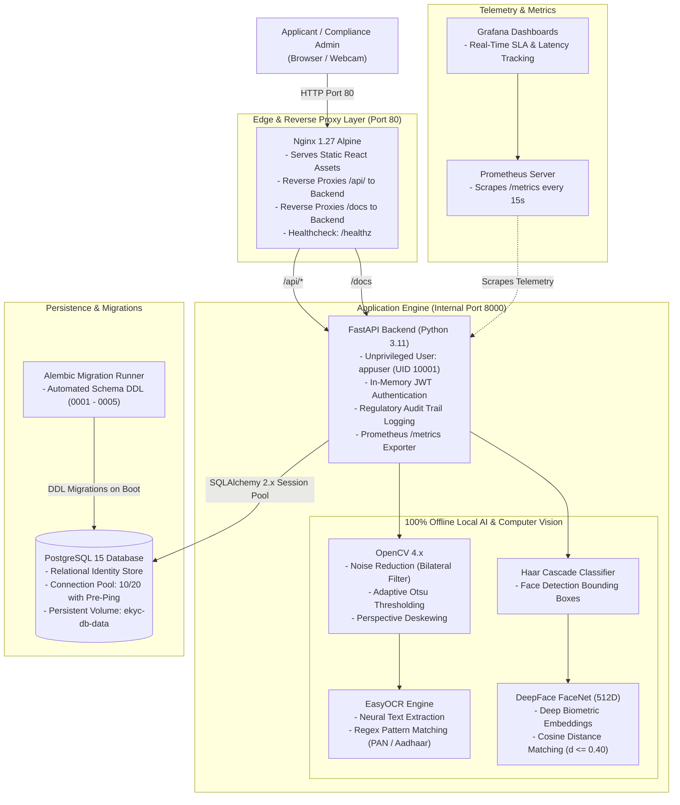

# AI-Powered E-KYC Identity Verification Platform

[](https://www.python.org/)
[](https://fastapi.tiangolo.com/)
[](https://react.dev/)
[](https://www.typescriptlang.org/)
[](https://www.postgresql.org/)
[](https://www.docker.com/)
[](https://kubernetes.io/)
[](https://about.gitlab.com/)
[](https://prometheus.io/)
[](LICENSE)

A production-ready, enterprise-grade, **AI-powered electronic Know-Your-Customer (e-KYC) identity verification platform**. 

The platform operates **100% locally and offline**: all computer vision processing, document text recognition (OCR), face detection, and deep biometric verification execute on your local infrastructure with **zero external cloud API keys**, **zero third-party subscriptions**, and **zero biometric data leakage**.

---

## 📚 Modular Documentation Hub

Detailed documentation is organized into dedicated sub-guides:

| Guide | Description | Location |
| :--- | :--- | :--- |
| 📖 **Complete Run & Deployment Guide** | Step-by-step instructions for running locally and deploying to a Linux server. | [`COMPLETE_RUN_AND_DEPLOYMENT_GUIDE.md`](COMPLETE_RUN_AND_DEPLOYMENT_GUIDE.md) |
| 🐳 **Docker & Compose Guide** | Multi-stage Dockerfiles, persistent volumes, networking, and service configs. | [`docker/README.md`](docker/README.md) |
| ☸️ **Kubernetes Guide** | Production Kustomize manifests, HPA, NetworkPolicies, StatefulSets, and Ingress. | [`k8s/README.md`](k8s/README.md) |
| 🦊 **GitLab CI/CD Guide** | Self-hosted GitLab CE Docker setup, branching workflow, and automated test pipelines. | [`gitlab/README.md`](gitlab/README.md) |
| 📊 **Monitoring & Observability** | Prometheus telemetry collectors, latency histograms, alerts, and Grafana dashboards. | [`monitoring/README.md`](monitoring/README.md) |
| 🐍 **Backend AI Architecture** | FastAPI engine, OpenCV preprocessing, EasyOCR, DeepFace FaceNet, and Alembic. | [`backend/README.md`](backend/README.md) |
| ⚛️ **Frontend Architecture** | React 18 SPA, in-memory JWT security, camera capture, and admin compliance portal. | [`frontend-react/README.md`](frontend-react/README.md) |

---

## 🏛️ System Architecture



---

## ✨ Key Features

- **100% Local AI Execution:** Complete offline operation with OpenCV, EasyOCR, and DeepFace FaceNet. No external cloud computer vision APIs or API keys required.
- **Biometric Face Verification:** Compares document photos with webcam selfies using 512D FaceNet embeddings. Employs cosine distance scoring with automated match thresholds.
- **Data Privacy & Ephemeral Processing:** Raw identity documents and facial crops are processed in memory or ephemeral cache and removed. Zero plaintext sensitive PII is stored.
- **Enterprise RBAC:** Role-Based Access Control (`ADMIN` vs `CUSTOMER`) powered by PyJWT, Bcrypt password hashing (`rounds=12`), and in-memory frontend token handling.
- **Automated Admin Provisioning:** Automatically provisions or synchronizes platform administrator credentials on boot from `.env`.
- **Compliance Portal & Dossier Review:** Dedicated administrative portal with server-side pagination, status filters, search, review modal, and mandatory explanation for rejections.
- **Regulatory Reporting:** CSV and Excel (`.xlsx`) export with built-in defense against Spreadsheet Formula Injection attacks (CWE-1236).
- **Observability & Health Monitoring:** Built-in Prometheus telemetry (`/metrics`), detailed database connectivity health check (`/api/v1/health`), and Grafana dashboard support.
- **Multi-Environment Ready:** One codebase deploys seamlessly across local bare-metal, Docker Compose, Kubernetes, or remote Linux VPS.

---

## ⚡ 3-Minute Quickstart (Docker Compose)

The entire full-stack application, database, and migrations can be launched with a single command:

```bash
# 1. Clone repository
git clone https://github.com/<your-username>/ai-ekyc-platform.git
cd ai-ekyc-platform

# 2. Configure environment
cp .env.example .env

# 3. Launch full stack
docker compose up --build -d
```

### Access Application:
- **Web Interface:** [http://localhost](http://localhost)
- **Interactive Swagger API Documentation:** [http://localhost/docs](http://localhost/docs)
- **Application Health Check:** [http://localhost/health](http://localhost/health)

### Default Credentials:
- **Admin Email:** `admin@ekyc-platform.com`
- **Admin Password:** `Admin@Secure2026!`

*(To shut down the platform: `docker compose down`)*

---

## 💻 Local Manual (Bare-Metal) Development

To run the backend and frontend directly on your local machine:

### 1. Start PostgreSQL Database
```bash
docker compose up -d db
```

### 2. Set Up Backend (FastAPI & Python 3.11+)
```bash
# Create and activate virtual environment
python -m venv .venv
source .venv/bin/activate   # On Windows: .venv\Scripts\Activate.ps1

# Install dependencies
pip install -r requirements.txt

# Run database migrations
alembic upgrade head

# Start backend server
python run_backend.py
```
*Backend is live at [http://127.0.0.1:8000](http://127.0.0.1:8000) (Swagger: [http://127.0.0.1:8000/docs](http://127.0.0.1:8000/docs)).*

### 3. Set Up Frontend (React 18 & Vite)
In a new terminal:
```bash
cd frontend-react
npm install
npm run dev
```
*Frontend is live at [http://127.0.0.1:5173](http://127.0.0.1:5173).*

---

## 🌐 Production Server Deployment (Linux VPS)

Deploying to a remote Ubuntu / Debian server:

```bash
# 1. Clone project onto server
git clone https://github.com/<your-username>/ai-ekyc-platform.git /opt/ekyc-platform
cd /opt/ekyc-platform

# 2. Configure production environment
cp .env.production.example .env
nano .env   # Update JWT_SECRET_KEY, POSTGRES_PASSWORD, and ADMIN_PASSWORD

# 3. Launch with Docker Compose
docker compose up --build -d

# 4. (Optional) Provision Free SSL with Let's Encrypt
sudo apt install -y certbot python3-certbot-nginx
sudo certbot --nginx -d ekyc.yourdomain.com
```

---

## ☸️ Kubernetes Deployment (Kustomize)

Deploy into any Kubernetes cluster (Minikube, Kind, EKS, GKE, AKS):

```bash
# 1. Configure production secrets
cp k8s/secret.example.yaml k8s/secret.yaml
# Edit k8s/secret.yaml with base64-encoded production credentials

# 2. Apply Kustomize manifests
kubectl apply -k k8s/

# 3. Verify rollout
kubectl get all -n ekyc-platform
```

---

## 🔒 Privacy, Database & Test Isolation

- **Zero Database Data on GitHub:** The repository strictly excludes database storage volumes (`db-data`), PostgreSQL dumps, SQLite database files (`*.sqlite*`, `*.db`), and real credentials (`.env`). Anyone cloning the repository uses Alembic migrations to initialize their own fresh, isolated database.
- **Local Test Isolation:** Comprehensive test suites (86 backend tests and 31 frontend tests) are maintained locally for verification and excluded from the public Git repository via `.gitignore` to keep the public codebase clean, private, and lightweight.
- **Type Checking & Build Validation:** TypeScript compilation (`npm run build`) and Python dependency verification validate the code structure.

---

## 🔒 Security, Compliance & Data Privacy

1. **In-Memory JWT Tokens:** Access tokens are stored strictly in memory; they are never exposed to `localStorage` or `sessionStorage` (mitigating XSS attacks).
2. **Spreadsheet Formula Injection Defense (CWE-1236):** All exported compliance reports neutralize formula injection characters (`=`, `+`, `-`, `@`).
3. **Data Minimization:** Document numbers are masked, biometric facial embeddings are kept in-memory, and raw uploads are deleted after processing.
4. **Non-Root Execution:** Docker containers run under unprivileged user IDs (`UID 10001`).
5. **Zero-Trust Network Policies:** Kubernetes manifests enforce strict egress/ingress isolation between frontend, backend, database, and telemetry pods.

---

## 📄 License

This project is licensed under the MIT License — see the [LICENSE](LICENSE) file for details.
