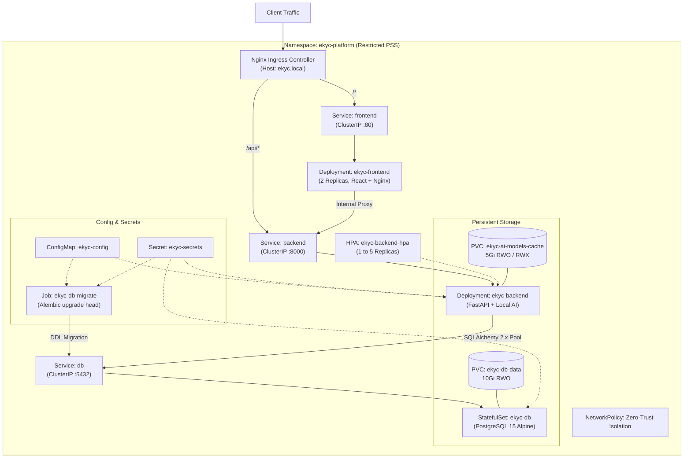

# AI-Powered E-KYC Identity Verification Platform

A modern, production-ready, AI-powered identity verification platform built with **Python FastAPI**, **PostgreSQL**, **SQLAlchemy 2.x**, **Alembic**, **React 18 + Vite + Tailwind CSS**, **OpenCV**, **EasyOCR**, and **DeepFace (FaceNet)**.

---

## Architecture Overview

```mermaid
flowchart TD
    Client["User Browser / Client\n(React 18 SPA)"]
    
    subgraph Docker_Compose["Docker Compose Orchestration (ekyc-network)"]
        subgraph Frontend_Proxy["Frontend & Gateway (Port 80)"]
            Nginx["Nginx Reverse Proxy\n- Serves Static React Assets\n- Reverse Proxies /api/ to Backend\n- Healthcheck: /healthz\n- 25MB Body Limit & 180s Timeout"]
        end

        subgraph Backend_App["FastAPI AI Engine (Port 8000)"]
            FastAPI["FastAPI Application\n- JWT Authentication & RBAC\n- Zero-PII Processing\n- Healthcheck: /api/v1/health\n- Non-root User (appuser UID 10001)"]
            
            subgraph AI_Engines["Local AI & Computer Vision Modules"]
                Haar["OpenCV Haar Cascade\n(Face Detection)"]
                EasyOCR["EasyOCR Engine\n(Document Text Extraction)"]
                FaceNet["DeepFace FaceNet\n(Facial Similarity Comparison)"]
            end
        end

        subgraph Database_Cluster["Data & Migrations"]
            PG["PostgreSQL 15 Database\n- Relational Identity Store\n- Persistent Volume: db-data\n- Healthcheck: pg_isready"]
            Migrate["Alembic Migration Runner\n(One-shot Service: migrate)\n- Runs upgrade head on startup"]
        end

        subgraph Named_Volumes["Persistent Docker Volumes"]
            VolDB[("ekyc-db-data\nPostgreSQL Data")]
            VolAI[("ekyc-ai-models-cache\nEasyOCR Model Weights")]
            VolLogs[("ekyc-backend-logs\nApplication Logs")]
        end
    end

    Client -->|HTTP Port 80| Nginx
    Nginx -->|/api/* (Internal)| FastAPI
    FastAPI -->|SQLAlchemy 2.x Pool| PG
    Migrate -->|Alembic DDL| PG
    FastAPI --> Haar
    FastAPI --> EasyOCR
    FastAPI --> FaceNet
    PG --- VolDB
    FastAPI --- VolAI
    FastAPI --- VolLogs
```

---

## Technology Stack

- **Frontend:** React 18, Vite, TypeScript, Tailwind CSS, Lucide React, Axios, React Router 6
- **Reverse Proxy:** Nginx 1.27 Alpine (SPA routing, gzip compression, security headers, reverse proxy)
- **Backend Framework:** FastAPI (Python 3.11), Uvicorn ASGI server
- **Database:** PostgreSQL 15+ (with connection pooling and pre-ping health checks)
- **ORM & Migrations:** SQLAlchemy 2.x (Mapped DeclarativeBase), Alembic
- **Authentication & RBAC:** JWT (PyJWT), Bcrypt password hashing (`rounds=12`), Role-Based Access Control (`ADMIN`, `CUSTOMER`)
- **Computer Vision & OCR:** OpenCV 4.x (headless), EasyOCR (English document recognition)
- **Biometric Verification:** DeepFace with FaceNet 512D deep embeddings and Haar Cascade face detection
- **Containerization:** Docker & Docker Compose (multi-stage builds, non-root security execution)
- **Observability & Monitoring:** Prometheus 2.54+, Grafana 11.2+, PostgreSQL Exporter, Node Exporter, kube-state-metrics

---

## Single-Command Containerized Deployment

The entire full-stack application and database can be launched with a single command:

```powershell
docker compose up --build -d
```

### 1. Prerequisites
- [Docker Desktop](https://www.docker.com/products/docker-desktop/) (v20.10+ or higher)
- Docker Compose (v2.0+ or higher)

### 2. Configure Environment
Copy `.env.example` to `.env` and configure your credentials:

```powershell
Copy-Item .env.example .env
```

Default configuration variables in `.env`:
```ini
POSTGRES_USER=postgres
POSTGRES_PASSWORD=postgres_secure_password_replace_in_prod
POSTGRES_DB=ekyc_db
FRONTEND_PORT=80
JWT_SECRET_KEY=change-this-in-production-to-a-secure-random-secret-key-at-least-32-bytes
```

### 3. Launch Services
Run Docker Compose in detached mode:

```powershell
docker compose up --build -d
```

### 4. Verify Startup & Service Health
Check that all containers are healthy:

```powershell
docker compose ps
```

Expected output:
```text
NAME            IMAGE               COMMAND                  SERVICE    STATUS
ekyc-db         postgres:15-alpine  "docker-entrypoint.s…"   db         Up (healthy)
ekyc-migrate    ekyc-migrate        "alembic upgrade hea…"   migrate    Exited (0)
ekyc-backend    ekyc-backend        "uvicorn backend.app…"   backend    Up (healthy)
ekyc-frontend   ekyc-frontend       "nginx -g 'daemon of…"   frontend   Up (healthy)
```

Healthcheck endpoints:
- **Frontend / Reverse Proxy:** `http://localhost/healthz` (Returns HTTP 200 OK)
- **Backend API:** `http://localhost/api/v1/health` (Returns PostgreSQL connectivity and system status)

### 5. Access the Application
Open your browser to:
- **Web UI:** [http://localhost](http://localhost) (or custom port configured in `FRONTEND_PORT`)
- **Interactive API Documentation:** `http://localhost/api/v1/docs` (when `APP_ENV=development`)

### 6. Provision Initial Administrator
To create an administrative user with elevated compliance privileges:

```powershell
docker compose exec backend python -m backend.scripts.create_admin --email admin@ekyc.local --name "Super Administrator" --password "Admin@Secure2026!"
```

### 7. Stopping and Resetting Services
- **Stop containers:**
  ```powershell
  docker compose down
  ```
- **Stop containers and remove persistent volumes (full reset):**
  ```powershell
  docker compose down -v
  ```

---

## Container Architecture & Design

### 1. Database (`db`)
- Official `postgres:15-alpine` image.
- Storage mounted to named volume `ekyc-db-data` for full persistence across rebuilds.
- Internal-only network access (`ekyc-network`); host port is not exposed by default for security.
- Healthcheck configured with `pg_isready`.

### 2. Migration Runner (`migrate`)
- Dedicated one-shot service running `alembic upgrade head`.
- Waits for `db` to become healthy before executing (`condition: service_healthy`).
- Terminates cleanly with exit code `0` once schema migrations are complete.
- Guaranteed zero duplicate migrations or startup race conditions.

### 3. FastAPI Backend (`backend`)
- Python 3.11-slim base image.
- Runs as non-root user `appuser` (UID `10001`).
- Waits for database health and migration completion (`condition: service_completed_successfully`).
- Mounts named volume `ekyc-ai-models-cache` to `/home/appuser/.EasyOCR` to avoid re-downloading OCR weights on restart.
- Mounts named volume `ekyc-backend-logs` to `/app/logs`.
- OpenCV system libraries (`libgl1`, `libglib2.0-0`, `libgomp1`) and PostgreSQL drivers (`libpq-dev`) pre-installed.

### 4. React Production Frontend (`frontend`)
- Multi-stage Docker build:
  - **Stage 1 (Builder):** `node:20-alpine` installs dependencies and compiles React SPA assets via `vite build`.
  - **Stage 2 (Runtime):** Lightweight `nginx:1.27-alpine-slim` serves static assets and reverse proxies `/api/` traffic.
- Custom Nginx configuration:
  - 25 MB request body limit (`client_max_body_size 25M`) for high-resolution document and selfie uploads.
  - 180-second upstream timeout for CPU-intensive AI biometric comparison.
  - Gzip compression on CSS, JS, SVG, and JSON.
  - Security headers (`X-Frame-Options SAMEORIGIN`, `X-Content-Type-Options nosniff`, `X-XSS-Protection`).
  - SPA fallback routing: `try_files $uri $uri/ /index.html`.

---

## Local Non-Docker Development Mode

For rapid local code iteration without Docker:

### 1. Python Environment Setup
```powershell
python -m venv .venv
.\.venv\Scripts\Activate.ps1
pip install -r requirements.txt
```

### 2. Database Migrations
Ensure local PostgreSQL is running on port 5432, then:
```powershell
alembic upgrade head
```

### 3. Start Backend
```powershell
python run_backend.py
# Runs FastAPI on http://127.0.0.1:8000
```

### 4. Start Frontend
In a separate terminal:
```powershell
python run_frontend.py
# Or: cd frontend-react && npm run dev
# Runs Vite dev server on http://localhost:5173
```

---

## AI Model Storage & Offline Inference

The platform utilizes local computer vision models with strict zero-PII storage principles:

1. **FaceNet Deep Embeddings:** Stored in `data/.deepface/weights/facenet_weights.pth` (91.5 MB). Pre-cached locally to avoid online weight downloads during runtime.
2. **Haar Cascade Face Detector:** Stored in `data/models/haarcascade_frontalface_default.xml` (930 KB).
3. **EasyOCR English Text Recognition:** Stored in `~/.EasyOCR/model/` (or mounted named volume `ekyc-ai-models-cache`).
4. **Pre-download / Verification Script:**
   ```powershell
   python -m backend.scripts.init_models
   ```
   Verifies model file presence, integrity, and loads detector modules to ensure offline readiness.
5. **Zero-PII Compliance:** Biometric embeddings and customer selfie photographs are processed in-memory and are never stored in the database or model cache volumes.

---

## Database Backup and Restore

### Backup PostgreSQL Data (Docker Compose)
```powershell
docker compose exec -T db pg_dump -U postgres ekyc_db > backup_ekyc.sql
```

### Restore PostgreSQL Data (Docker Compose)
```powershell
docker compose exec -T db psql -U postgres ekyc_db < backup_ekyc.sql
```

---

## Kubernetes Deployment & Orchestration

The platform includes a complete, enterprise-grade Kubernetes configuration located in [`k8s/`](file:///c:/Users/arya%20singh/EKYC/Project1/k8s) orchestrated using Kustomize.



### 1. Prerequisites
- `kubectl` CLI installed and configured.
- A running Kubernetes cluster (Docker Desktop Kubernetes, Minikube, Kind, or managed cloud EKS/GKE/AKS).
- Ingress-Nginx Controller (for routing):
  ```powershell
  kubectl apply -f https://raw.githubusercontent.com/kubernetes/ingress-nginx/controller-v1.11.1/deploy/static/provider/cloud/deploy.yaml
  ```

### 2. Configure Secrets
Never commit real production secrets. Create the Kubernetes Secret directly via `kubectl`:

```powershell
kubectl apply -f k8s/namespace.yaml

kubectl create secret generic ekyc-secrets `
  --namespace=ekyc-platform `
  --from-literal=POSTGRES_USER=postgres `
  --from-literal=POSTGRES_PASSWORD='YourStrongSecurePassword123!' `
  --from-literal=JWT_SECRET_KEY='$(python -c "import secrets; print(secrets.token_urlsafe(48))")' `
  --from-literal=DATABASE_URL='postgresql://postgres:YourStrongSecurePassword123!@db:5432/ekyc_db'
```

### 3. Deploy Complete Stack via Kustomize
Deploy all resources (Namespace, Storage, ConfigMap, Database StatefulSet, Migration Job, Backend, Frontend, Ingress, NetworkPolicies, and HPA) with a single command:

```powershell
kubectl apply -k k8s/
```

### 4. Monitor Deployment Status
Check the status of Pods, Services, and Persistent Volume Claims:

```powershell
# Check Pods
kubectl get pods -n ekyc-platform -o wide

# Check Services
kubectl get svc -n ekyc-platform

# Check Persistent Volume Claims
kubectl get pvc -n ekyc-platform

# View migration job execution
kubectl logs -n ekyc-platform job/ekyc-db-migrate

# View backend application logs
kubectl logs -n ekyc-platform deployment/ekyc-backend -f
```

### 5. Accessing the Application
1. **Via Ingress (Recommended):**
   Map `ekyc.local` to `127.0.0.1` in your hosts file (`C:\Windows\System32\drivers\etc\hosts` or `/etc/hosts`):
   ```text
   127.0.0.1  ekyc.local
   ```
   Open [http://ekyc.local](http://ekyc.local) in your browser.

2. **Via Port-Forwarding (Local Development / Debugging):**
   ```powershell
   kubectl port-forward svc/frontend 8080:80 -n ekyc-platform
   # Access Web UI at http://localhost:8080
   ```

### 6. Provision Initial Administrator in Kubernetes
```powershell
kubectl exec -it -n ekyc-platform deployment/ekyc-backend -- python -m backend.scripts.create_admin --email admin@ekyc.local --name "Super Administrator" --password "Admin@Secure2026!"
```

### 7. Database Backup & Restore in Kubernetes
- **Backup PostgreSQL Database:**
  ```powershell
  kubectl exec -i -n ekyc-platform statefulset/ekyc-db -- pg_dump -U postgres ekyc_db > k8s_backup_ekyc.sql
  ```
- **Restore PostgreSQL Database:**
  ```powershell
  kubectl exec -i -n ekyc-platform statefulset/ekyc-db -- psql -U postgres ekyc_db < k8s_backup_ekyc.sql
  ```

### 8. Rerunning Database Migrations After Updates
When releasing a new application version with schema changes:
```powershell
kubectl delete job ekyc-db-migrate -n ekyc-platform
kubectl apply -f k8s/migrations/migration-job.yaml
```

### 9. Teardown / Cleanup
```powershell
kubectl delete -k k8s/
```

---

## Observability & Monitoring Stack (Prometheus & Grafana)

The e-KYC platform includes an enterprise monitoring and observability suite orchestrated via Kubernetes in the `ekyc-platform` namespace.

### Architecture Components

1. **Prometheus Server (`prometheus:9090`)**:
   - Collects telemetry at 15-second scrape intervals.
   - 15-day TSDB data retention on `prometheus-data-pvc` (10Gi).
   - Scrape Targets:
     - `ekyc-api` (`backend:8000/metrics`) - FastAPI latency, throughput, OCR/biometrics timing, errors.
     - `postgres-exporter` (`postgres-exporter:9187/metrics`) - Connection saturation, transactions, deadlocks, cache hits.
     - `node-exporter` (`node-exporter:9100/metrics`) - Host CPU, memory, root filesystem disk metrics.
     - `kube-state-metrics` (`kube-state-metrics:8080/metrics`) - Pod statuses, container restarts, replica counts.
     - `prometheus` (`localhost:9090`) - TSDB engine health.

2. **Grafana Visualization (`grafana:3000`)**:
   - Automated datasource provisioning pointing to `http://prometheus:9090`.
   - Automated file-based dashboard provisioning from `/var/lib/grafana/dashboards`.
   - Runs as non-root user (UID `472`) with persistent storage on `grafana-data-pvc` (5Gi).
   - Pre-installed with 4 comprehensive production dashboards:
     - **Dashboard A: Application Overview** - Throughput (RPS), HTTP 5xx error rate, p50/p95/p99 response latency, active requests, route breakdown.
     - **Dashboard B: KYC Processing & Biometrics** - Document ingestion counts (PAN vs Aadhaar), EasyOCR processing duration, FaceNet comparison duration, biometric match vs mismatch ratios, KYC workflow state distributions, and algorithmic limitations disclosure.
     - **Dashboard C: PostgreSQL Performance** - Database status (`pg_up`), connection pool saturation, storage size, transaction commits vs rollbacks, buffer cache hit ratio, deadlocks.
     - **Dashboard D: Kubernetes Infrastructure** - Pod status and health, container restart loops, node CPU and memory saturation curves, deployment replica tracking.

3. **Prometheus Alert Rules (`k8s/monitoring/prometheus/alert-rules.yaml`)**:
   - `BackendUnavailable`: FastAPI backend is down for $> 1$ min (Critical).
   - `PostgreSQLUnavailable`: Database unreachable for $> 1$ min (Critical).
   - `HighHttp5xxErrorRate`: HTTP 5xx errors $> 5\%$ over 5 min (Warning).
   - `HighApiResponseLatency`: Tail API response latency p95 $> 2$s over 5 min (Warning).
   - `HighCpuUtilization`: Node CPU utilization $> 85\%$ for 5 min (Warning).
   - `HighMemoryUtilization`: Node memory usage $> 85\%$ for 5 min (Warning).
   - `FrequentPodRestarts`: Pod container restarts $> 3$ in 15 min (Warning).
   - `DeploymentReplicasUnavailable`: Available replicas $<$ desired replicas for 5 min (Warning).
   - `PostgreSqlConnectionSaturation`: Connection pool capacity $> 80\%$ for 5 min (Warning).
   - `DiskSpaceCriticallyLow`: Root filesystem free disk space $< 15\%$ (Critical).

### Accessing Prometheus and Grafana Dashboards

Both Prometheus and Grafana are deployed with internal `ClusterIP` services by default to adhere to zero-trust security principles. Use `kubectl port-forward` to securely access them on your local workstation:

#### 1. Access Grafana Dashboard
```powershell
kubectl port-forward -n ekyc-platform svc/grafana 3000:3000
```
- Open your browser to: [http://localhost:3000](http://localhost:3000)
- **Default Username:** `admin`
- **Default Password:** `replace_with_a_secure_grafana_password_min_16_chars` (configure in `k8s/monitoring/grafana/secret.example.yaml`)

#### 2. Access Prometheus Expression Browser
```powershell
kubectl port-forward -n ekyc-platform svc/prometheus 9090:9090
```
- Open your browser to: [http://localhost:9090](http://localhost:9090)
- View active targets: [http://localhost:9090/targets](http://localhost:9090/targets)
- View active alert rules: [http://localhost:9090/alerts](http://localhost:9090/alerts)

#### 3. Access Backend Raw Metrics Directly
```powershell
kubectl port-forward -n ekyc-platform svc/backend 8000:8000
```
- Endpoint: [http://localhost:8000/metrics](http://localhost:8000/metrics)

---

## Automated Verification & Testing

### Backend Test Suite (Pytest)
Run the 86 backend unit and integration tests (including Prometheus metrics):
```powershell
pytest backend/tests -v
```

### Frontend Test Suite (Vitest)
Run the 31 frontend component and workflow tests:
```powershell
cd frontend-react
npm run test
```

### Frontend Typecheck & Production Build
```powershell
cd frontend-react
npm run lint    # Executes tsc --noEmit
npm run build   # Compiles production bundle
```

---

## Troubleshooting Guide

| Issue | Root Cause | Resolution |
| :--- | :--- | :--- |
| **Port 80 Already in Use** | Local IIS, Apache, or Skype occupying port 80. | Set `FRONTEND_PORT=8080` in `.env` and run `docker compose up -d`. |
| **Docker Daemon Not Running** | Docker Desktop application is closed. | Start Docker Desktop from the Start Menu, wait for the engine icon to turn green, and retry. |
| **Database Connection Refused** | PostgreSQL container still initializing. | Wait for `db` container to reach `healthy` status (`docker compose ps`). |
| **Migration Service Fails** | Database credentials mismatch in `.env`. | Ensure `POSTGRES_USER` and `POSTGRES_PASSWORD` match in `.env` and `DATABASE_URL`. |
| **AI Model Download Timeout** | Slow or restricted network during first EasyOCR run. | Mount `ekyc-ai-models-cache` volume or run `python -m backend.scripts.init_models` before building. |
| **Document Upload 413 Error** | Document image exceeds maximum allowed size. | Uploaded documents must be $\le 5$ MB (Nginx proxy limit is 25 MB). |
