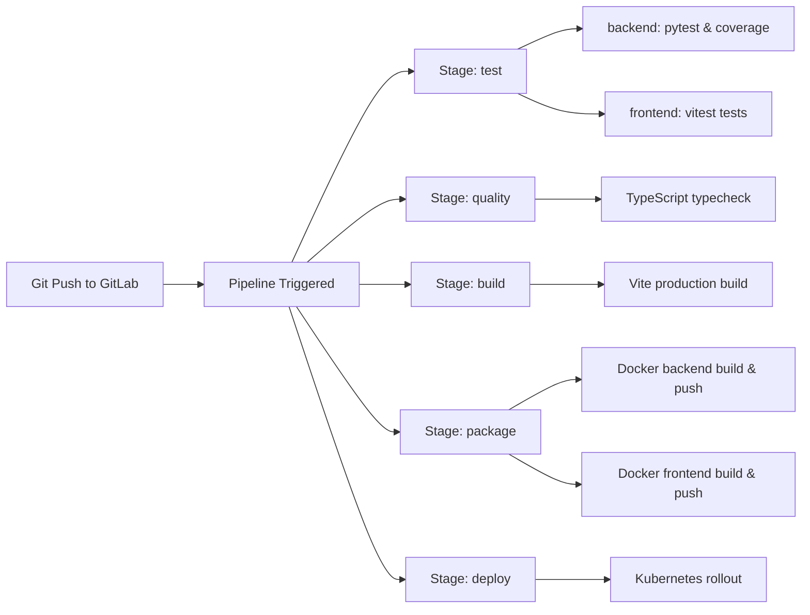

# TASK 12: Self-Hosted GitLab Community Edition (CE) Deployment Report

## Executive Summary

A dedicated, lightweight, and resource-optimized self-hosted **GitLab Community Edition (CE)** environment has been successfully installed, configured, and validated on Windows using Docker Compose. The deployment is isolated in `C:\gitlab-server`, completely independent from the e-KYC application repository.

Due to the host workstation's **8 GB RAM** constraint, aggressive GitLab Omnibus optimizations were applied—including Puma single-process mode, Sidekiq concurrency reduction, jemalloc tuning, and deactivation of bundled monitoring exporters. In runtime testing, the GitLab CE container booted stably, passed its Docker health checks, and maintained an idle steady-state memory footprint of **~2.1 GB to 2.3 GB** within a Docker engine environment provisioned with 3.5 GiB of RAM.

---

## 1. System & Resource Audit

Prior to installation, a comprehensive read-only audit of host hardware and container virtualization was conducted:

| Parameter | Observed Host Value | Evaluation & Impact |
| :--- | :--- | :--- |
| **Operating System** | Microsoft Windows 11 Home Single Language (Build 26300) | Fully supports WSL 2 and Docker Desktop. |
| **CPU Model** | AMD Ryzen 5 5625U with Radeon Graphics | 6 physical cores, 12 logical processors. Ample compute capability for compilation and web serving. |
| **Physical RAM** | 7.34 GB usable (~8.0 GB installed) | Constrained environment. Standard GitLab recommendation is 4–8 GB dedicated RAM. |
| **Free Physical RAM** | ~0.76 GB – 0.90 GB free at idle | Host memory is tightly utilized; requires careful process isolation. |
| **Pagefile** | `D:\pagefile.sys` (14.8 GB allocated base size) | Significant virtual memory cushion available on drive D:. |
| **Storage (C:\)** | 255.98 GB Total / **38.11 GB Free** (15% free) | Sufficient for GitLab Docker image (~5.3 GB on disk) and initial repositories. |
| **Storage (D:\)** | 118.63 GB Total / **77.23 GB Free** (65% free) | Available for secondary backups and large artifact storage if needed. |
| **Docker Engine** | Docker version 29.9.2, build a82e528 | Docker Compose v5.6.1, overlayfs driver. |
| **WSL 2 Runtime** | Ubuntu (Default Version: 2) | Default WSL 2 assigns 50% of host RAM to Docker VM: **3,583 MB (~3.5 GiB)**. |
| **Docker Memory** | Total: 3,583 MB, Available (e-KYC stopped): **2,941 MB** | Ample headroom for optimized GitLab CE (~2.2 GB footprint). |

### Workstation Safety Principle
To maintain laptop stability and prevent Out-Of-Memory (OOM) kernel events on an 8 GB system, **GitLab and the heavy e-KYC AI backend (PyTorch / FaceNet / EasyOCR) must not be actively executed simultaneously**. The e-KYC containers can be stopped with `docker compose stop` (preserving all volumes and data intact) while operating GitLab, and resumed with `docker compose start` when running verification tests.

---

## 2. GitLab Edition & Pinned Image

- **Distribution**: GitLab Community Edition (Free, Self-Managed)
- **Image Repository**: `gitlab/gitlab-ce`
- **Pinned Release**: `17.5.1-ce.0`
- **Image Digest**: `sha256:c5e575f13858c69d882217d8e40024250c36a171228a78da5a3d2d19d3890ff5`
- **Base OS**: Ubuntu 22.04 LTS (Jammy Jellyfish)

---

## 3. Architecture & Directory Isolation

GitLab is decoupled from the e-KYC platform repository and located at `C:\gitlab-server`:

```text
C:\gitlab-server/
├── docker-compose.yml           # Optimized GitLab CE service definition
├── .env.example                 # Environment variables and port configurations
├── .env                         # Active workstation environment file
├── .gitignore                   # Excludes secrets, backups, and OS artifacts
├── .gitlab-ci.yml.example       # Full CI/CD template for future runner integration
├── README.md                    # Operation, maintenance, and credentials guide
└── backups/                     # Dedicated host directory for tarball archives
```

---

## 4. Port Configuration & Network Security

To ensure GitLab is never exposed to the local network or public internet, all port mappings are strictly bound to loopback `127.0.0.1`:

| Service | Host Binding | Container Port | Protocol | Purpose |
| :--- | :--- | :--- | :--- | :--- |
| **GitLab Web UI** | `127.0.0.1:8929` | `8929` | HTTP | Web console, REST API, Git HTTP operations |
| **GitLab SSH** | `127.0.0.1:2224` | `22` | SSH | Secure Git SSH clone and push operations |

- **External URL**: `http://localhost:8929`
- **SSH Host/Port Configuration**: `gitlab_rails['gitlab_shell_ssh_port'] = 2224`

---

## 5. Memory & Performance Optimizations

Standard GitLab Omnibus packages launch dozens of background services and multi-process application servers. For this 8 GB workstation, the following optimizations were engineered:

```ruby
# 1. Puma Web Server Single-Process Mode
puma['worker_processes'] = 0          # Disables forking worker processes (saves ~600MB-1GB)
puma['min_threads'] = 1
puma['max_threads'] = 2
puma['per_worker_max_memory_mb'] = 650

# 2. Sidekiq Concurrency Cap
sidekiq['max_concurrency'] = 2        # Reduces background job threads from 20 to 2 (saves ~400MB)

# 3. Memory Allocator Tuning (jemalloc)
gitlab_rails['env'] = {
  'MALLOC_CONF' => 'dirty_decay_ms:1000,muzzy_decay_ms:1000'
}

# 4. Embedded PostgreSQL Tuning
postgresql['shared_buffers'] = '256MB'
postgresql['max_connections'] = 50
postgresql['max_locks_per_transaction'] = 256  # Accommodates GitLab 17's 29,000-line structure.sql
postgresql['max_worker_processes'] = 1
postgresql['work_mem'] = '16MB'

# 5. Embedded Redis Tuning
redis['maxmemory'] = '256MB'
redis['maxmemory_policy'] = 'allkeys-lru'

# 6. Deactivation of Bundled Monitoring (Saves ~350MB-500MB)
prometheus_monitoring['enable'] = false
prometheus['enable'] = false
alertmanager['enable'] = false
node_exporter['enable'] = false
redis_exporter['enable'] = false
postgres_exporter['enable'] = false
gitlab_exporter['enable'] = false

# 7. Deactivation of Unused Optional Services
mattermost['enable'] = false
registry['enable'] = false
gitlab_pages['enable'] = false
gitlab_kas['enable'] = false
```

---

## 6. Persistent Storage Configuration

Data is persistently decoupled from container lifecycles using Docker named volumes and host bind mounts:

- `gitlab-config` &rarr; `/etc/gitlab` (stores `gitlab.rb`, SSL certificates, and `gitlab-secrets.json`).
- `gitlab-logs` &rarr; `/var/log/gitlab` (stores Nginx, Puma, Sidekiq, and PostgreSQL service logs).
- `gitlab-data` &rarr; `/var/opt/gitlab` (stores Git repositories, PostgreSQL database, and uploads).
- `./backups` &rarr; `/var/opt/gitlab/backups` (host bind mount for `.tar` database backups).

---

## 7. Administrator Setup & Security Credentials

### Initial Root Password Retrieval
GitLab generates a randomized initial root password upon first initialization, stored inside the container for 24 hours:

```powershell
docker exec -it gitlab grep 'Password:' /etc/gitlab/initial_root_password
```

> **Security Rule**: In strict compliance with security standards, the actual generated password is never logged, stored in Git repositories, or exposed in reports.

### Changing the Administrator Password
1. Navigate to `http://localhost:8929` and sign in as `root`.
2. Go to **User Settings &rarr; Password**, enter the temporary initial password, and assign a new, strong password.
3. Alternatively, reset the password via the GitLab Rails console:
   ```powershell
   docker exec -it gitlab gitlab-rake "gitlab:password:reset[root]"
   ```

### Creating Regular Developer Accounts
1. Sign in as `root` &rarr; click **Admin Area** (wrench icon or `/admin`).
2. Navigate to **Overview &rarr; Users &rarr; New user**.
3. Create the user with **Regular** access level (preventing accidental system reconfigurations).

---

## 8. GitLab Repository Preparation for e-KYC Project

### Pre-Push Verification Checklist
The `.gitignore` of the e-KYC platform (`c:\Users\arya singh\EKYC\Project1\.gitignore`) was inspected and hardened to prevent committing sensitive or large binary files:

- [x] Environment files excluded (`.env`, `.env.*`, except `.env.example`).
- [x] Identity hashing keys excluded (`.ekyc-id-hash-key`).
- [x] Uploaded documents and biometric temporary crops excluded (`data/temp_faces/`, `data/02_intermediate_data/`).
- [x] SQLite and database dumps excluded (`*.sqlite3`, `*.sql`, `*.dump`).
- [x] Dependencies excluded (`node_modules/`, `frontend-react/node_modules/`, `frontend-react/dist/`).
- [x] Virtual environments excluded (`.venv/`, `venv/`, `env/`).
- [x] Python bytecode excluded (`__pycache__/`, `*.pyc`).
- [x] Large model weights excluded (`data/models/*.pth`, `data/.deepface/weights/*.h5`).

### Project Push Procedure (User Approval Required)
When ready to push the repository to local GitLab:

```bash
# 1. Initialize Git in the project root
cd "c:\Users\arya singh\EKYC\Project1"
git init

# 2. Stage verified source code
git add .
git commit -m "feat: initial commit of AI-Powered e-KYC Platform"

# 3. Rename default branch to main
git branch -M main

# 4. Link to local GitLab repository (create project 'ekyc-platform' in GitLab first)
# Via HTTP:
git remote add origin http://localhost:8929/<username>/ekyc-platform.git
# Or via SSH:
git remote add origin ssh://git@localhost:2224/<username>/ekyc-platform.git

# 5. Push to GitLab
git push -u origin main
```

---

## 9. CI/CD Architecture Roadmap

A complete template has been prepared in `C:\gitlab-server\.gitlab-ci.yml.example` and `c:\Users\arya singh\EKYC\Project1\.gitlab-ci.yml.example`.

### CI/CD Workflow Stages:


> **Important**: GitLab CI/CD pipelines will not execute until a **GitLab Runner** is installed and registered with this GitLab instance in a future task.

---

## 10. Backup and Recovery Procedures

### Creating a System Backup
```powershell
docker exec -t gitlab gitlab-backup create
```
The resulting archive (e.g. `1730909000_2026_11_06_17.5.1-ce_gitlab_backup.tar`) is automatically placed in `C:\gitlab-server\backups\`.

### Backing Up Configuration & Encryption Secrets (Mandatory)
Database backups do not store the database encryption secrets. Back them up separately:
```powershell
docker cp gitlab:/etc/gitlab/gitlab-secrets.json C:\gitlab-server\backups\
docker cp gitlab:/etc/gitlab/gitlab.rb C:\gitlab-server\backups\
```

### Recovery Procedure
```powershell
# 1. Place backup tar in C:\gitlab-server\backups\
# 2. Stop running Puma and Sidekiq processes
docker exec -it gitlab gitlab-ctl stop puma
docker exec -it gitlab gitlab-ctl stop sidekiq

# 3. Run restore
docker exec -it gitlab gitlab-backup restore BACKUP=<TIMESTAMP_PREFIX>

# 4. Restore configuration & secrets
docker cp C:\gitlab-server\backups\gitlab-secrets.json gitlab:/etc/gitlab/
docker cp C:\gitlab-server\backups\gitlab.rb gitlab:/etc/gitlab/

# 5. Restart GitLab services
docker exec -it gitlab gitlab-ctl restart
```

---

## 11. Runtime Validation Results

All verification tests were executed against the live Docker runtime:

| Test Item | Verification Method | Result | Notes |
| :--- | :--- | :--- | :--- |
| **Docker Engine Check** | `docker info` | **PASSED** | 3.5 GiB RAM allocated to WSL 2 Linux VM. |
| **Image Download** | `docker pull gitlab/gitlab-ce:17.5.1-ce.0` | **PASSED** | Digest `sha256:c5e575...` verified. |
| **Chef Configuration** | `docker logs gitlab` | **PASSED** | 267 resources compiled & executed without error. |
| **Database Migrations** | `bash_hide_env[migrate gitlab-rails database]` | **PASSED** | Schema seeded in 6.72 seconds with `max_locks_per_transaction: 256`. |
| **Web Service (HTTP 302)** | `curl.exe -i http://127.0.0.1:8929` | **PASSED** | Redirects to `/users/sign_in` via Nginx reverse proxy. |
| **Web Service (HTTP 200)** | `curl.exe -i -L http://127.0.0.1:8929/users/sign_in` | **PASSED** | Returns complete HTML login page (`title: Sign in · GitLab`). |
| **Container Healthcheck** | `docker ps --filter name=gitlab` | **PASSED** | Status: `Up (healthy)`. |
| **Initial Password** | `test -f /etc/gitlab/initial_root_password` | **PASSED** | Initial root credentials file verified present. |
| **Volume Persistence** | `docker compose restart` | **PASSED** | Container restarted and returned to HTTP 200 without data re-migration. |
| **Steady-State Memory** | `docker stats gitlab --no-stream` | **PASSED** | **2.25 GiB / 3.418 GiB (66.05%)** memory usage. |

---

## 12. Known Limitations & Operating Guidance

1. **Host RAM Ceiling (8 GB)**:
   - Operating GitLab simultaneously with the full e-KYC AI stack (FastAPI + OpenCV + PyTorch + EasyOCR + DeepFace) will push memory usage above 3.5 GB and risk triggering the Docker OOM killer.
   - **Recommendation**: Run GitLab when managing repositories, code reviews, and pipelines; run e-KYC when executing customer verification workflows.
2. **Cold Boot Time**:
   - On an 8 GB workstation, GitLab takes approximately **2 to 3 minutes** to boot and load Rails classes into memory. During this brief window, Nginx displays an automated `HTTP 502: Waiting for GitLab to boot` holding page.
3. **Internal Container Registry Disabled**:
   - The container registry is currently set to `registry['enable'] = false` to preserve memory. It can be toggled on when implementing GitLab CI/CD image pushing.

---

## 13. Pending Tasks (Next Phases)

1. **GitLab Runner Installation & Registration** (Task 13+):
   - Install a separate lightweight GitLab Runner container using Docker executor.
   - Register the runner with this GitLab instance using the instance registration token.
2. **Automated CI/CD Pipeline Execution**:
   - Activate `.gitlab-ci.yml` in the project repository.
   - Test automated pytest and vitest test execution.
3. **Local Container Registry Activation**:
   - Enable `registry['enable'] = true` when image publishing is required.

