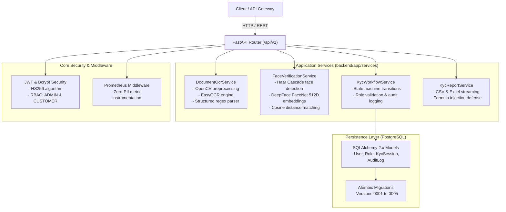

# FastAPI AI Backend Engine Guide

This directory contains the Python FastAPI backend engine for the **AI-Powered E-KYC Identity Verification Platform**.

---

## 1. Backend Architecture



---

## 2. Directory Structure

```
backend/
├── app/
│   ├── api/
│   │   ├── v1/
│   │   │   ├── auth.py            # Registration, login, profile, admin user management
│   │   │   ├── health.py          # Detailed runtime and database health endpoint
│   │   │   ├── kyc.py             # OCR upload, face verification, admin review, export
│   │   │   └── router.py          # API v1 route aggregator
│   │   └── deps.py                # Reusable auth dependencies (get_current_user, require_admin)
│   ├── core/
│   │   ├── config.py              # Pydantic Settings (.env configuration validation)
│   │   ├── metrics.py             # Prometheus metrics collectors & middleware
│   │   └── security.py            # Bcrypt hashing, JWT generation, password validation
│   ├── db/
│   │   ├── base.py                # SQLAlchemy DeclarativeBase
│   │   └── session.py             # Engine creation, connection pooling, check_db_connection
│   ├── models/                    # SQLAlchemy database models
│   │   ├── audit_log.py           # Regulatory immutable audit logs
│   │   ├── kyc_session.py         # Verification sessions with OCR and biometric status
│   │   ├── role.py                # Role definitions (ADMIN, CUSTOMER)
│   │   └── user.py                # User credentials, active state, verification status
│   ├── schemas/                   # Pydantic request/response validation schemas
│   └── services/                  # Business logic services
│       ├── face_service.py        # FaceNet biometric comparison service
│       ├── ocr_service.py         # Document OCR extraction service
│       ├── report_service.py      # CSV and Excel export with CWE-1236 sanitization
│       └── workflow_service.py    # State machine engine for KYC applications
├── migrations/                    # Alembic schema migration versions (0001 - 0005)
├── scripts/
│   └── create_admin.py            # Administrator provisioning and synchronization script
├── tests/                         # Pytest test suite (86 automated tests)
├── config.yaml                    # Computer vision hyperparameters
└── requirements.txt               # Backend dependencies
```

---

## 3. Local Computer Vision & Biometric Pipeline

The platform runs **100% locally** without requiring cloud computer vision APIs or third-party inference keys:

### A. Document OCR Processing
1. **Preprocessing (OpenCV):**
   - Image validation (minimum resolution $300 \times 300$, maximum size 25MB, format whitelist).
   - Bilateral filtering to preserve text edges while reducing sensor noise.
   - Otsu adaptive thresholding and deskew correction.
2. **Text Recognition (EasyOCR):**
   - Uses PyTorch-based neural network models running locally.
3. **Structured Entity Extraction:**
   - **PAN Card:** Strict regex extraction matching `[A-Z]{5}[0-9]{4}[A-Z]{1}`.
   - **Aadhaar Card:** 12-digit number extraction with masking (storing only last 4 digits) and Verhoeff algorithm checksum validation.
4. **Data Minimization:**
   - Raw document images and full document numbers are never written unmasked to permanent database storage.

### B. Biometric Facial Verification
1. **Face Detection:**
   - OpenCV Haar Cascade (`haarcascade_frontalface_default.xml`) extracts face crops from both the identity document and live webcam selfie.
2. **512-Dimensional Deep Embeddings:**
   - DeepFace with the **FaceNet** model generates normalized 512D feature vectors.
3. **Cosine Similarity Matching:**
   - Computes cosine distance $d = 1 - \frac{u \cdot v}{\|u\|_2 \|v\|_2}$.
   - If distance $d \le 0.40$, the faces are verified as a **MATCH** (Confidence $\ge 85\%$).
4. **Ephemeral Storage:**
   - Face crops in `data/temp_faces/` are strictly ephemeral and removed after vector extraction.

---

## 4. Database Schema & Migration History

Alembic manages the PostgreSQL schema:

```
0001_initial_schema               Creates 'roles' and 'users' tables
        │
0002_add_kyc_ocr_fields           Creates 'kyc_sessions' table with document fields
        │
0003_add_face_verification_fields Adds face match score, distance, and status columns
        │
0004_add_kyc_workflow_fields      Adds workflow status and creates 'audit_logs' table
        │
0005_add_performance_indexes     Adds btree indexes on session status, dates, and user_id
```

To run migrations:
```bash
alembic upgrade head
```

---

## 5. Security & RBAC Enforcement

- **JWT Tokens:** Signed using HS256 algorithm with strict expiration (default: 60 minutes).
- **Password Hashing:** Passwords hashed using Bcrypt with 12 salt rounds.
- **Admin Boot Sync:** On startup, the backend automatically provisions or updates the administrator specified in `.env` (`ADMIN_EMAIL`, `ADMIN_PASSWORD`).
- **CWE-1236 Defense:** Compliance exports neutralize spreadsheet formula injection attacks by escaping cells starting with `=`, `+`, `-`, or `@`.

---

## 6. Running Locally & Testing

### Launch Backend
```bash
# In virtual environment:
python run_backend.py

# Or via Uvicorn:
uvicorn backend.app.main:app --host 127.0.0.1 --port 8000 --reload
```

### Run Test Suite
```bash
pytest backend/tests/ -v
```
All 86 tests run against an isolated SQLite in-memory database.
