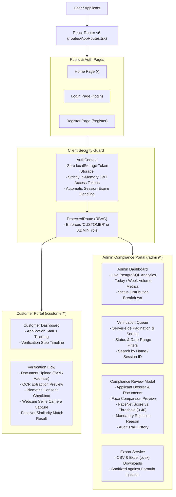

# React 18 Modern Frontend Guide

This directory contains the single-page application (SPA) frontend for the **AI-Powered E-KYC Identity Verification Platform**, built with **React 18**, **Vite**, **TypeScript**, and **Tailwind CSS**.

---

## 1. Frontend Architecture & Flow



---

## 2. Directory Structure

```
frontend-react/
├── public/                        # Static assets (shield.svg, favicon)
├── src/
│   ├── components/                # UI components
│   │   ├── common/                # Reusable design system primitives
│   │   │   ├── Alert.tsx          # Dismissible alerts (success, error, warning, info)
│   │   │   ├── Button.tsx         # Accessible buttons with loading spinners & icons
│   │   │   ├── Card.tsx           # Rounded border surfaces with subtle elevation
│   │   │   ├── Footer.tsx         # Platform compliance and transparency disclosures
│   │   │   ├── Input.tsx          # Inputs with error states & password toggle
│   │   │   ├── LoadingSpinner.tsx # Centered SVG spinner
│   │   │   └── Navbar.tsx         # Responsive navigation bar with role-based links
│   │   ├── kyc/                   # Domain-specific verification components
│   │   │   ├── FaceVerificationCamera.tsx # Live webcam capture & biometric consent
│   │   │   └── KycReviewModal.tsx # Admin application review modal with dossier
│   │   └── layout/                # Layout shells (MainLayout, DashboardLayout)
│   ├── context/
│   │   └── AuthContext.tsx        # In-memory authentication provider
│   ├── hooks/
│   │   └── useAuth.ts             # Hook for consuming authentication context
│   ├── pages/
│   │   ├── admin/
│   │   │   ├── AdminDashboard.tsx # Overview statistics and CSV/Excel exports
│   │   │   ├── SystemHealth.tsx   # Live telemetry and uptime monitoring
│   │   │   ├── UserManagement.tsx # User list and account status toggling
│   │   │   └── VerificationQueue.tsx # Filterable, paginated verification table
│   │   ├── customer/
│   │   │   ├── CustomerDashboard.tsx # Personal status, profile, and steps
│   │   │   └── VerificationFlow.tsx  # Multi-step OCR and biometric verification flow
│   │   ├── Home.tsx               # Public landing page
│   │   ├── Login.tsx              # User login with rate-limiting error handling
│   │   └── Register.tsx           # Customer registration with password complexity
│   ├── routes/
│   │   ├── AppRoutes.tsx          # Route switchboard definitions
│   │   └── ProtectedRoute.tsx     # Role-based route guard
│   ├── services/
│   │   ├── api.ts                 # Axios client with dynamic API resolution
│   │   └── authService.ts         # Authentication HTTP calls
│   └── test/                      # Vitest & React Testing Library test suites (31 tests)
├── nginx.conf                     # Production Nginx reverse proxy configuration
├── package.json                   # Dependencies and scripts
└── vite.config.ts                 # Vite build & Vitest test runner configuration
```

---

## 3. In-Memory Security & Zero Persistent Token Storage

To prevent Cross-Site Scripting (XSS) token exfiltration attacks:
- JWT access tokens are stored **exclusively in memory variables** inside `api.ts` and `AuthContext.tsx`.
- Tokens are **never written** to `localStorage`, `sessionStorage`, or unhardened cookies.
- When the user refreshes or closes the browser tab, the session terminates cleanly.

---

## 4. Dynamic API Base URL Resolution

[`src/services/api.ts`](src/services/api.ts) dynamically resolves the backend address:

```typescript
const API_BASE_URL =
  import.meta.env.VITE_API_BASE_URL !== undefined
    ? import.meta.env.VITE_API_BASE_URL
    : import.meta.env.PROD
    ? ''                       // In production, use relative paths (proxied by Nginx)
    : 'http://127.0.0.1:8000'; // In dev, directly target local FastAPI backend
```

- **Local Development (`npm run dev`):** Requests target `http://127.0.0.1:8000`.
- **Production (`docker compose` or server):** Requests use relative paths (e.g. `/api/v1/auth/login`), which Nginx seamlessly proxies internally to `backend:8000`.

---

## 5. Development & Testing Commands

### Install Dependencies
```bash
npm install
```

### Start Vite Development Server
```bash
npm run dev
```
Available at [http://127.0.0.1:5173](http://127.0.0.1:5173).

### Run Local Automated Tests (Vitest)
```bash
# Tests are maintained locally and excluded from public git
npm test
```
Executes all 31 unit, integration, and component tests using `jsdom`.

### Compile Production Bundle
```bash
npm run build
```
Runs TypeScript static type checking (`tsc`) followed by Vite production bundling into `/dist`.
