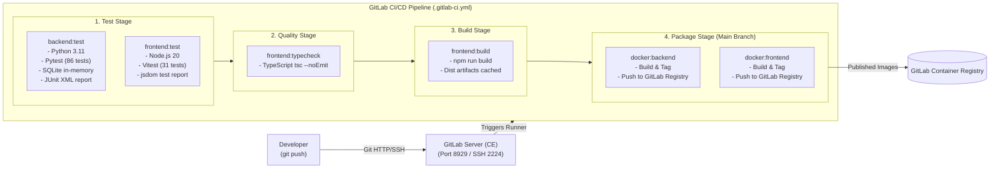

# GitLab CI/CD & Self-Hosted Server Guide

This guide details the integration, branching workflows, and automated CI/CD pipeline for the **AI-Powered E-KYC Identity Verification Platform** using **GitLab Community Edition (CE)**.

---

## 1. Architecture Overview



---

## 2. Resource-Optimized Self-Hosted GitLab Setup (8 GB RAM Laptops)

GitLab CE typically demands 4 to 8 GB RAM by default. For local developer laptops with 8 GB total memory, GitLab CE can be run inside Docker using this resource-constrained `docker-compose.yml`:

```yaml
services:
  gitlab:
    image: gitlab/gitlab-ce:17.5.1-ce.0
    container_name: gitlab
    restart: unless-stopped
    hostname: localhost
    environment:
      GITLAB_OMNIBUS_CONFIG: |
        external_url 'http://localhost:8929'
        gitlab_rails['gitlab_shell_ssh_port'] = 2224
        
        # 1. Puma Web Server Tuning (Single worker, memory watchdog)
        puma['worker_processes'] = 0
        puma['min_threads'] = 1
        puma['max_threads'] = 4
        puma['per_worker_max_memory_mb'] = 1400

        # 2. Sidekiq Background Job Tuning
        sidekiq['max_concurrency'] = 2

        # 3. PostgreSQL Database Tuning
        postgresql['shared_buffers'] = '256MB'
        postgresql['max_connections'] = 50
        postgresql['max_locks_per_transaction'] = 256

        # 4. Disable Unnecessary Background Services
        prometheus_monitoring['enable'] = false
        grafana['enable'] = false
        alertmanager['enable'] = false
        gitlab_exporter['enable'] = false
    ports:
      - '127.0.0.1:8929:8929'
      - '127.0.0.1:2224:22'
    volumes:
      - gitlab-config:/etc/gitlab
      - gitlab-logs:/var/log/gitlab
      - gitlab-data:/var/opt/gitlab
    shm_size: '256m'
    deploy:
      resources:
        limits:
          memory: 3500M

volumes:
  gitlab-config:
  gitlab-logs:
  gitlab-data:
```

*This configuration achieves a stable footprint of ~2.2 GB RAM, leaving 5+ GB free for Windows, IDE, and development.*

---

## 3. Git Workflow & Branching Strategy

The repository follows standard Git branching conventions:

| Branch | Purpose | Protection Level | Deployment Target |
| :--- | :--- | :--- | :--- |
| **`main`** | Production-stable codebase. Direct commits forbidden. | Protected (Requires MR approval & passing CI). | Production Kubernetes / Docker Compose. |
| **`develop`** | Integration branch for verified feature merges. | Protected (Requires passing CI). | Staging / QA Environment. |
| **`feature/<name>`** | New capability development (e.g. `feature/face-liveness`). | Unprotected. | Local Developer Machine. |
| **`bugfix/<name>`** | Defect resolution (e.g. `bugfix/cors-parsing`). | Unprotected. | Local Developer Machine. |

### Standard Merge Request Workflow
1. Create a feature branch:
   ```bash
   git checkout -b feature/biometric-enhancement
   ```
2. Commit changes using Conventional Commits:
   ```bash
   git commit -m "feat(cv): add contrast adjustment filter to document preprocessor"
   ```
3. Push to GitLab and open a Merge Request targeting `develop`:
   ```bash
   git push -u origin feature/biometric-enhancement
   ```
4. Verify that the GitLab CI pipeline passes all tests before merging.

---

## 4. CI/CD Pipeline Stages (`.gitlab-ci.yml`)

The pipeline runs automatically on merge requests and branch pushes:

### Stage 1: `test`
- **`backend:test`:**
  - Base Image: `python:3.11-slim`
  - Runs 86 unit and integration tests using an isolated in-memory SQLite database (`DATABASE_URL=sqlite:///:memory:`).
  - Produces standard JUnit XML test reports (`artifacts:reports:junit`).
- **`frontend:test`:**
  - Base Image: `node:20-alpine`
  - Runs 31 Vitest unit and component tests with mock DOM (`jsdom`).

### Stage 2: `quality`
- **`frontend:typecheck`:**
  - Executes `tsc --noEmit` to ensure strict TypeScript type safety across all React components, context, and API clients.

### Stage 3: `build`
- **`frontend:build`:**
  - Compiles the optimized production React bundle via `npm run build`.
  - Retains `/dist` directory as a downloadable artifact.

### Stage 4: `package` (Runs on `main` branch only)
- Uses Docker-in-Docker (`docker:24-dind`) to build:
  - `backend:$CI_COMMIT_SHORT_SHA` from `Dockerfile.backend`.
  - `frontend:$CI_COMMIT_SHORT_SHA` from `Dockerfile.frontend`.
- Pushes both images to the built-in GitLab Container Registry.

---

## 5. Registering a Local GitLab Runner

To execute jobs on your local machine:

1. Obtain the registration token from GitLab:
   - Navigate to: **Admin Area** > **CI/CD** > **Runners** > **New Instance Runner**.
   - Copy the generated runner token.
2. Start and register the runner via Docker:
   ```bash
   docker run -d --name gitlab-runner --restart always \
     -v /var/run/docker.sock:/var/run/docker.sock \
     -v gitlab-runner-config:/etc/gitlab-runner \
     gitlab/gitlab-runner:latest
   ```
3. Register the runner:
   ```bash
   docker exec -it gitlab-runner gitlab-runner register \
     --url "http://host.docker.internal:8929" \
     --registration-token "<YOUR_TOKEN>" \
     --executor "docker" \
     --docker-image "python:3.11-slim" \
     --docker-privileged \
     --description "Local Docker Executor"
   ```

