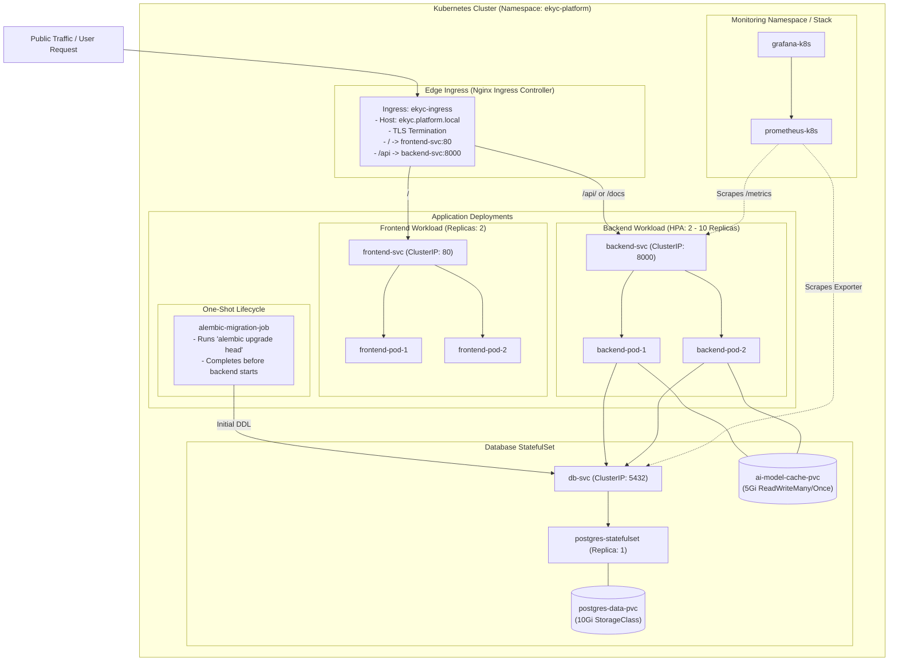

# Kubernetes Kustomize Deployment Guide

This directory contains the production-ready Kubernetes declarative manifests for the **AI-Powered E-KYC Identity Verification Platform**, managed via **Kustomize**.

---

## 1. Kubernetes Architecture Overview



---

## 2. Directory Structure & Manifest Catalog

```
k8s/
├── backend/
│   ├── deployment.yaml            # FastAPI backend deployment (2 replicas, resources, probes)
│   ├── hpa.yaml                   # Horizontal Pod Autoscaler (2-10 replicas based on CPU/RAM)
│   └── service.yaml               # ClusterIP service exposing port 8000
├── database/
│   ├── pvc.yaml                   # PersistentVolumeClaim for PostgreSQL (10Gi)
│   ├── service.yaml               # Headless/ClusterIP service on port 5432
│   └── statefulset.yaml           # PostgreSQL 15 StatefulSet with health probes
├── frontend/
│   ├── deployment.yaml            # React + Nginx deployment (2 replicas)
│   └── service.yaml               # ClusterIP service exposing port 80
├── ingress/
│   └── ingress.yaml               # Nginx Ingress routing for / and /api
├── migrations/
│   └── migration-job.yaml         # One-shot Alembic migration Kubernetes Job
├── monitoring/                    # Kubernetes monitoring manifests
│   ├── grafana/                   # Grafana deployment and service
│   ├── kube-state-metrics/        # Cluster-level Kubernetes metrics
│   ├── node-exporter/             # DaemonSet node hardware metrics
│   ├── postgres-exporter/         # PostgreSQL metrics exporter
│   ├── prometheus/                # Prometheus server deployment and ConfigMap
│   ├── kustomization.yaml         # Monitoring sub-kustomization
│   └── networkpolicy.yaml         # Monitoring network isolation
├── storage/
│   └── ai-model-cache-pvc.yaml    # Persistent volume for EasyOCR neural network weights
├── configmap.yaml                 # Non-sensitive environment variables
├── secret.example.yaml            # Secret template for DB password and JWT secret
├── namespace.yaml                 # Dedicated 'ekyc-platform' namespace
├── networkpolicy.yaml             # Zero-trust network segmentation policies
└── kustomization.yaml             # Master Kustomize manifest
```

---

## 3. Security & Zero-Trust Policies

1. **Dedicated Namespace Isolation:**
   All components run in `ekyc-platform`.
2. **Unprivileged Container Execution:**
   Pods run with restricted security contexts:
   - `runAsNonRoot: true`
   - `runAsUser: 10001`
   - `allowPrivilegeEscalation: false`
   - `capabilities: drop: ["ALL"]`
3. **NetworkPolicy Segmentation (`networkpolicy.yaml`):**
   - **Frontend**: Ingress permitted only from Ingress controller; egress only to Backend on port 8000.
   - **Backend**: Ingress permitted only from Frontend and Ingress; egress permitted only to PostgreSQL on port 5432.
   - **Database**: Ingress permitted only from Backend pods and Migration Job on port 5432. External traffic is completely blocked.
   - **Monitoring**: Scrape access permitted strictly to `/metrics` endpoints.

---

## 4. Step-by-Step Deployment Instructions

### Prerequisites
- Kubernetes cluster (v1.26+): Minikube, Kind, k3s, EKS, GKE, or AKS.
- `kubectl` CLI installed.
- Nginx Ingress Controller installed in the cluster.

---

### Step 1: Prepare Production Secrets
Copy the example secret manifest:

```bash
cp k8s/secret.example.yaml k8s/secret.yaml
```

Generate secure credentials and encode them in base64:
```bash
# Generate base64 password
echo -n "YourSecurePostgresPassword#2026" | base64

# Generate base64 JWT secret
echo -n "YourSecureJwtKey32BytesLongSecret#" | base64
```

Update `k8s/secret.yaml` with the generated base64 strings.

Update `k8s/kustomization.yaml` to reference `secret.yaml` instead of `secret.example.yaml`:
```yaml
resources:
  - namespace.yaml
  - configmap.yaml
  - secret.yaml   # <-- Use secret.yaml
  ...
```

---

### Step 2: Deploy Using Kustomize

Apply the entire stack with a single command:

```bash
kubectl apply -k k8s/
```

*Kustomize will automatically apply the namespace, ConfigMaps, Secrets, PVCs, StatefulSets, Jobs, Deployments, Services, and Ingress.*

---

### Step 3: Verify Deployment Rollout

```bash
# Check all resources in the ekyc-platform namespace
kubectl get all -n ekyc-platform

# Verify PersistentVolumeClaims are Bound
kubectl get pvc -n ekyc-platform

# Verify Migration Job completed successfully
kubectl get jobs -n ekyc-platform

# Check Pod logs for the backend
kubectl logs -n ekyc-platform -l app.kubernetes.io/name=backend --tail=50
```

---

### Step 4: Access Application Without Ingress (Port-Forwarding)

If testing on local clusters (such as Minikube or Kind) without an Ingress controller:

```bash
# Forward Frontend to localhost:8080
kubectl port-forward -n ekyc-platform svc/frontend-svc 8080:80

# In a separate terminal, forward Backend to localhost:8000
kubectl port-forward -n ekyc-platform svc/backend-svc 8000:8000
```

Now open [http://localhost:8080](http://localhost:8080) in your browser.

---

### Step 5: Rolling Updates & Zero Downtime Deployments

To update the backend image with zero downtime:

```bash
kubectl set image deployment/backend-deployment backend=<your-registry>/backend:v1.1.0 -n ekyc-platform

# Monitor rolling update status
kubectl rollout status deployment/backend-deployment -n ekyc-platform

# Rollback immediately in case of failure
kubectl rollout undo deployment/backend-deployment -n ekyc-platform
```

---

### Step 6: Teardown

To remove all resources:

```bash
kubectl delete -k k8s/
```

