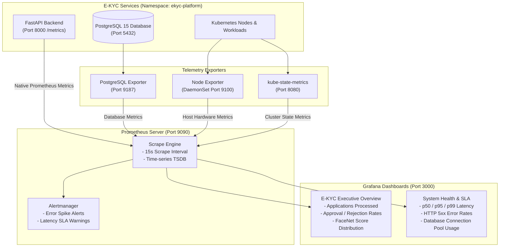

# Monitoring & Observability Guide

This guide details the telemetry, metrics instrumentation, Prometheus scrapers, and Grafana visualization setup for the **AI-Powered E-KYC Identity Verification Platform**.

---

## 1. Observability Architecture



---

## 2. Platform Metric Declarations

The backend implements custom Prometheus collectors defined in [`backend/app/core/metrics.py`](../backend/app/core/metrics.py):

### A. HTTP Request & Traffic Metrics

| Metric Name | Type | Labels | Description |
| :--- | :--- | :--- | :--- |
| **`http_requests_total`** | Counter | `method`, `endpoint`, `status_code` | Total count of HTTP requests processed by the platform. |
| **`http_request_duration_seconds`** | Histogram | `method`, `endpoint` | Request latency in seconds (Buckets: 10ms to 60s). |
| **`http_active_requests`** | Gauge | `method` | Count of concurrent in-flight requests currently being processed. |
| **`application_errors_total`** | Counter | `error_type`, `endpoint` | Total count of unhandled exceptions and server errors. |

### B. AI Domain & KYC Verification Metrics

| Metric Name | Type | Labels | Description |
| :--- | :--- | :--- | :--- |
| **`kyc_document_uploads_total`** | Counter | `document_type`, `status` | Identity document uploads (PAN vs Aadhaar) and success/error status. |
| **`kyc_ocr_duration_seconds`** | Histogram | `document_type` | Time taken by OpenCV preprocessing and EasyOCR text extraction. |
| **`kyc_face_verifications_total`** | Counter | `status` | Total biometric comparisons (`MATCH` vs `NO_MATCH`). |
| **`kyc_face_verification_duration_seconds`** | Histogram | None | Processing latency for DeepFace FaceNet inference. |
| **`kyc_workflow_status_count`** | Gauge | `status` | Active sessions in each status (`DRAFT`, `PENDING_ADMIN_REVIEW`, `APPROVED`, `REJECTED`). |

---

## 3. High-Cardinality Prevention & PII Protection

To protect Prometheus performance and comply with data privacy regulations:

1. **Path Normalization:**
   Dynamic parameters (UUIDs and IDs) are automatically replaced with template wildcards before label assignment:
   - `/api/v1/kyc/sessions/550e8400-e29b-41d4-a716-446655440000/review` $\rightarrow$ `/api/v1/kyc/sessions/{session_id}/review`
2. **Strict Zero-PII Policy:**
   Metrics labels **never** contain customer names, document numbers, email addresses, or facial embeddings.

---

## 4. Prometheus Scrape Configurations

### A. Docker Compose Scrape Configuration (`monitoring/prometheus-compose.yml`)
```yaml
global:
  scrape_interval: 15s
  evaluation_interval: 15s

scrape_configs:
  - job_name: ekyc-api
    metrics_path: /metrics
    static_configs:
      - targets: ["backend:8000"]
```

### B. Kubernetes Scrape Configuration (`monitoring/prometheus-kubernetes.yml`)
```yaml
global:
  scrape_interval: 15s
  evaluation_interval: 15s

scrape_configs:
  - job_name: ekyc-api
    metrics_path: /metrics
    static_configs:
      - targets: ["backend-svc.ekyc-platform.svc.cluster.local:8000"]
```

---

## 5. Exporters Catalog

| Exporter | Image | Port | Description |
| :--- | :--- | :--- | :--- |
| **PostgreSQL Exporter** | `prometheuscommunity/postgres-exporter:v0.15.0` | `9187` | Tracks database connection pool saturation, cache hit ratios, transaction commits, and table row counts. |
| **Node Exporter** | `prom/node-exporter:v1.8.2` | `9100` | Gathers node-level metrics: CPU utilization, available memory, disk I/O latency, and network throughput. |
| **kube-state-metrics** | `registry.k8s.io/kube-state-metrics/kube-state-metrics:v2.13.0` | `8080` | Listens to the Kubernetes API server and generates metrics on the health of Deployments, Pods, and PVCs. |

---

## 6. Accessing Telemetry

When running the application:
- **Raw Prometheus Metrics:** [http://127.0.0.1:8000/metrics](http://127.0.0.1:8000/metrics)
- **Prometheus Web UI (if deployed):** [http://localhost:9090](http://localhost:9090)
- **Grafana Web Dashboard (if deployed):** [http://localhost:3000](http://localhost:3000) (Default user: `admin`, password: `admin_password`)
